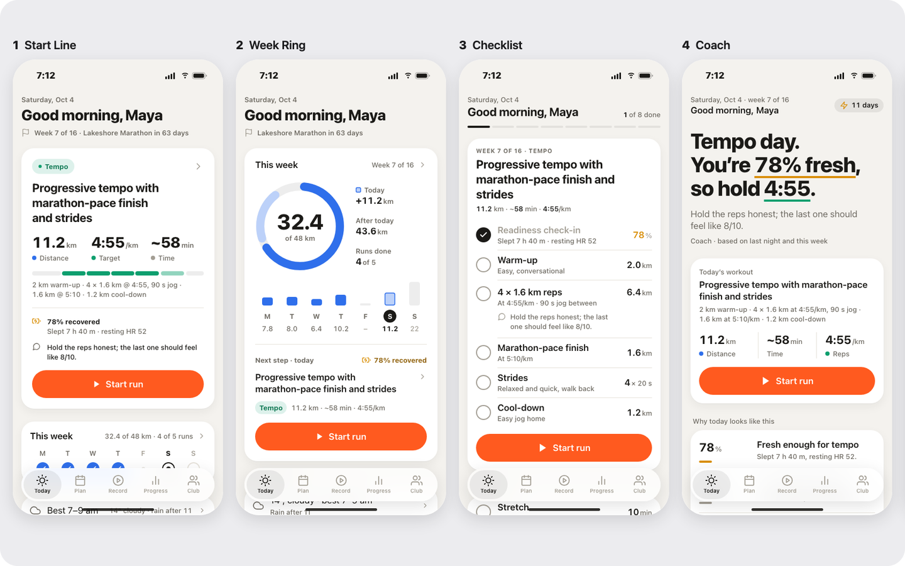
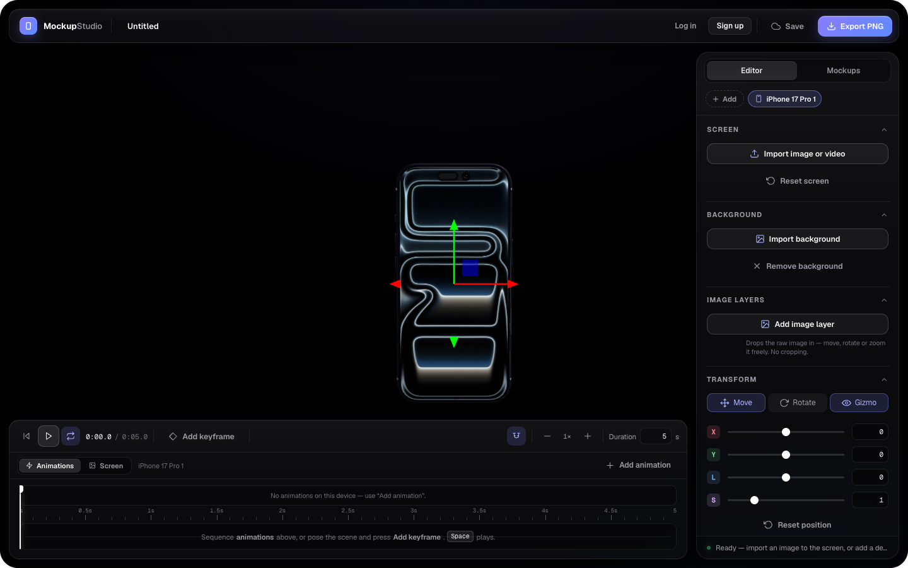
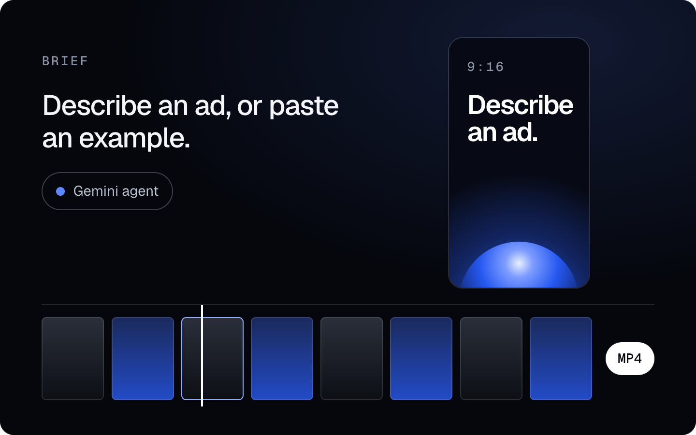
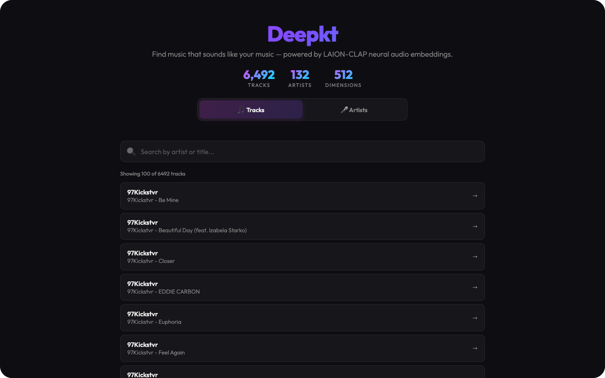
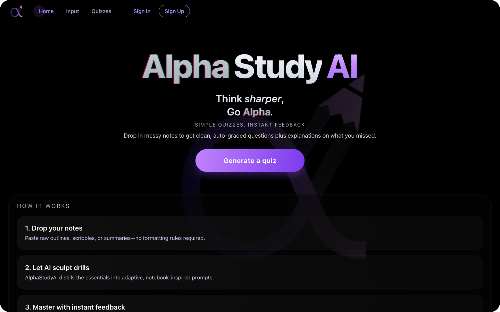

<h1 align="center"><a href="https://adrianpartain.com">Adrian Partain</a></h1>

  <a href="https://adrianpartain.com"><b>adrianpartain.com</b></a>

  <b>I build apps end to end: design, code and the paywall.</b> 
  Founding engineer at <a href="https://pepaiapp.com">Pep AI</a> · founder of <a href="https://miloeating.com">Milo</a>

  <a href="https://cal.com/adrian-partain-zrj5nw">Book a call</a> ·
  <a href="https://www.linkedin.com/in/adrianpartain/">LinkedIn</a> ·
  <a href="mailto:adrianpartain@outlook.com">Email</a>

 

## Experience

### &nbsp; Pep AI

**Founding engineer** · 2026 – now · [pepaiapp.com](https://pepaiapp.com)

A peptide and GLP-1 tracking app: dosing, schedules, nutrition and an AI coach.

**200,000** downloads · **$50K+** MRR · **$750K+** total revenue

- Build across the whole product: the iOS and Android app (React Native, Expo), the backend (Node, Firebase) and the AI coach.
- Run the paywall and onboarding experiments. They lifted conversion by 10%.
- Design new features from mockup to release, and own the analytics that decide what ships next.

### &nbsp; Milo

**Founder** · 2026 · [miloeating.com](https://miloeating.com)

Know what to order wherever you eat. Scan a menu, a meal or a barcode, see restaurant favorites, and track calories and macros around your goals.

 

> I also help founders turn downloads into revenue: onboarding, paywalls and the analytics behind them. [Book a call →](https://cal.com/adrian-partain-zrj5nw)

 

## Projects

<table>
  <tr>
    <td width="50%" valign="top">
      
      <h3>Tenfold</h3>
      
An open-source Claude Code plugin for mobile UI design. Ask for a screen and it renders ten genuinely different directions as phone mockups, built on your app's own design tokens. It tells you which one it would ship, then iterates on the one you pick.

      
<a href="https://adrianpartain59.github.io/tenfold/tempo/today/r1/">Live demo</a> · <a href="https://github.com/adrianpartain59/tenfold">Code</a>

    </td>
    <td width="50%" valign="top">
      
      <h3>Mockup Studio</h3>
      
Put any screen on a 3D iPhone 17 Pro, right in the browser. Pose it, animate it on a timeline and export a PNG. Studio lighting gives it real reflections, and there's nothing to install.

      
<a href="https://adrianpartain59.github.io/Mockked/">Open it</a> · <a href="https://github.com/adrianpartain59/Mockked">Code</a>

    </td>
  </tr>
  <tr>
    <td width="50%" valign="top">
      
      <h3>AI Ad Studio</h3>
      
Describe an ad, or paste one you like, and a Gemini agent builds an animated social ad: layout, copy, fresh imagery and 3D iPhone mockups. Then edit every frame by hand and export a 4K MP4.

      
<a href="https://github.com/adrianpartain59/AdGenerator">Code</a>

    </td>
    <td width="50%" valign="top">
      
      <h3>Deepkt</h3>
      
Music discovery for niche genres like phonk, based on the sound itself rather than tags or plays. Neural audio embeddings find tracks that sound like yours across 6,492 tracks from 132 artists.

      
<a href="https://deepkt.vercel.app">Open it</a> · <a href="https://adrianpartain59.github.io/DeepktDemo/">Demo</a> · <a href="https://github.com/adrianpartain59/Deepkt">Code</a>

    </td>
  </tr>
  <tr>
    <td width="50%" valign="top">
      
      <h3>AlphaStudyAI</h3>
      
Turns your notes, a PDF or just a topic into adaptive quizzes. Short answers are graded by AI, and a tutor in the sidebar knows which questions you got wrong.

      
<a href="https://alphastudyai.vercel.app">Open it</a> · <a href="https://github.com/adrianpartain59/AlphaStudyAI">Code</a>

    </td>
    <td width="50%" valign="top">
      
      <h3>AlgolRun</h3>
      
A space-themed infinite runner built in Unity, which you can play right in the browser. This is where it started: games first, then apps, tools and AI.

      
<a href="https://adrianpartain59.github.io/AlgolRun_Public/">Play it</a> · <a href="https://github.com/adrianpartain59/AlgolRun_Public">Code</a>

    </td>
  </tr>
</table>

Also: [Point Cloud Visualizer](https://adrianpartain59.github.io/PointCloudVisualizer/), a tool for generative point-cloud art in the browser · [Blue Bird](https://adrianpartain59.github.io/BlueBird/) and my other [early games](https://github.com/adrianpartain59/Games)

 

## About

I started with games, then moved to apps, tools and AI. These days I'm into AI design tools, 3D in the browser and music discovery. I studied computer science at the University of Oregon.

 <a href="https://adrianpartain.com"><b>adrianpartain.com →</b></a>

